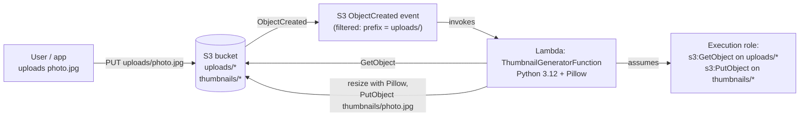

# AWS Serverless Image Processor

An **S3 → Lambda** pipeline: dropping an image into `uploads/` in an S3 bucket triggers a Lambda function that resizes it into a thumbnail and writes it to `thumbnails/` in the same bucket — no server, no queue, no polling. Built while studying the serverless/compute portion of the **AWS Certified Cloud Practitioner (CLF-C02)** exam.

> ⚠️ **Status**: the thumbnail-resizing logic (`resize_image()` in `src/thumbnail_generator/app.py`) is **pure Python + Pillow with no AWS dependency, and its unit tests were actually run in this environment — all 3 pass** (`pytest tests/ -v` → `3 passed`). The **SAM template, the S3 event trigger wiring, and the deployed Lambda have not been tested against real AWS** — this environment has no AWS credentials or the SAM CLI installed. See [Testing](#testing) for exactly what was and wasn't verified.

## Table of contents
- [Learning objectives](#learning-objectives)
- [Use case](#use-case)
- [Architecture](#architecture)
- [Why these services](#why-these-services)
- [Repository structure](#repository-structure)
- [Setup](#setup)
- [Testing](#testing)
- [Cleanup](#cleanup)
- [Cost considerations](#cost-considerations)
- [Security notes](#security-notes)
- [Troubleshooting](#troubleshooting)
- [Limitations & future improvements](#limitations--future-improvements)
- [References](#references)

## Learning objectives

After working through this lab you should be able to:
- Explain **event-driven architecture**: a resource (S3) emits an event, a consumer (Lambda) reacts — no polling, no always-on server.
- Configure an **S3 event notification** scoped to a specific key prefix (`uploads/`), and explain why that prefix filter matters here specifically (to avoid the Lambda's own output in `thumbnails/` re-triggering itself).
- Explain Lambda's execution model: cold starts, the `/tmp` ephemeral storage (used here to stage the image during resizing), timeout, and memory/CPU scaling together.
- Write a Lambda **execution role** scoped to exactly `s3:GetObject` on `uploads/*` and `s3:PutObject` on `thumbnails/*` — not a wildcard S3 policy.
- Use AWS SAM to define a serverless app (function + event source + IAM) as a single template instead of clicking through the console.

## Use case

A content platform lets users upload photos. Every upload needs a small thumbnail generated automatically for use in listings/previews, without the upload request itself waiting on image processing (the upload returns immediately; the thumbnail appears moments later, asynchronously).

## Architecture



The event filter on `uploads/` is what prevents an infinite loop: the Lambda's own `PutObject` into `thumbnails/` does **not** match the trigger's prefix, so it doesn't re-invoke itself.

## Why these services

| Service | Why it was chosen |
|---|---|
| **Lambda** | Pay only for actual invocations (image uploads), zero idle cost, scales automatically with upload volume. |
| **S3 event notifications** | Native, no polling, no extra queue needed for a single consumer like this. |
| **AWS SAM** | Purpose-built for exactly this pattern (function + event source + scoped IAM) — less boilerplate than hand-written CloudFormation, and supports `sam local invoke` for offline testing. |
| **Pillow** | The standard Python imaging library for resizing — needs a Lambda-compatible build, which is why `sam build --use-container` matters (see [Setup](#setup)). |

## Repository structure

```
aws-serverless-image-processor/
├── README.md
├── LICENSE
├── .gitignore
├── template.yaml                        # SAM template: bucket, function, event source, IAM policy
├── src/
│   └── thumbnail_generator/
│       ├── app.py                       # Lambda handler + resize_image() (pure, unit-testable)
│       └── requirements.txt             # Pillow
├── tests/
│   └── test_app.py                      # Unit tests for resize_image() — actually run, 3/3 passing
└── events/
    └── s3-put-event.json                # Sample S3 ObjectCreated event for `sam local invoke`
```

## Setup

**Prerequisites**: AWS account, [AWS SAM CLI](https://docs.aws.amazon.com/serverless-application-model/latest/developerguide/install-sam-cli.html), Docker (needed for `--use-container`, since Pillow has compiled components that must match Lambda's Amazon Linux runtime), AWS CLI v2 configured.

```bash
# Build with --use-container so Pillow's compiled parts match Lambda's runtime,
# not your local OS (this matters even on Linux — glibc versions can differ).
sam build --use-container

sam deploy --guided
# First run: choose a stack name, region, and a value for the BucketName parameter
# (must be globally unique). Confirm IAM role creation when prompted.
```

## Testing

**What was actually run, in this environment, right now:**
```bash
pip install Pillow pytest boto3
pytest tests/ -v
```
Result: **3 passed** — `resize_image()` correctly shrinks large images to fit within 200×200, preserves aspect ratio, and never upscales a smaller-than-target image. This part needs no AWS account at all.

**What you should run yourself after deploying** (not verified here — no AWS access in this environment):
1. `sam local invoke ThumbnailGeneratorFunction -e events/s3-put-event.json` after editing the bucket name in that event file to match a real bucket you've uploaded a matching test key into — exercises the full handler locally against real S3 reads/writes.
2. After `sam deploy`, upload a real image: `aws s3 cp test.jpg s3://<bucket>/uploads/test.jpg`.
3. Check CloudWatch Logs for the function (`sam logs -n ThumbnailGeneratorFunction --tail`) for the `Created thumbnail: s3://...` line.
4. Confirm the thumbnail exists: `aws s3 ls s3://<bucket>/thumbnails/`.
5. Confirm the **negative/safety** case: upload a file directly under `thumbnails/` — it must **not** trigger the function (the event filter only matches `uploads/`), so no infinite loop occurs.

## Cleanup

```bash
sam delete
```
This removes the stack (Lambda function, IAM role, event notification) but **does not empty the S3 bucket first** — do that yourself if the bucket has objects in it:
```bash
aws s3 rm s3://<bucket> --recursive
```

## Cost considerations

- **Lambda Free Tier**: 1,000,000 free requests and 400,000 GB-seconds of compute per month, indefinitely (not just 12 months) — a learning/demo volume of image uploads stays comfortably inside this.
- At 512 MB memory and a typical few-hundred-millisecond execution time per image, costs beyond the free tier would still be a small fraction of a cent per thumbnail — [check current Lambda pricing](https://aws.amazon.com/lambda/pricing/).
- S3 storage/requests for test images are within the S3 Free Tier for any reasonable test volume.
- No idle cost: unlike an EC2-based image processor, this invoices **$0** when no one is uploading images.

## Security notes

- The Lambda execution role is scoped to exactly `s3:GetObject` on `uploads/*` and `s3:PutObject` on `thumbnails/*` in this one bucket — not `AmazonS3FullAccess`, not even access to other prefixes in the same bucket.
- The S3 bucket blocks all public access; nothing in this lab is reachable from the internet except through whatever application later serves the thumbnails (out of scope for this lab).
- `/tmp` files are deleted in a `finally` block after every invocation, so a warm (reused) execution environment doesn't accumulate leftover image data across invocations.
- No credentials are embedded anywhere — the Lambda authenticates to S3 purely via its execution role.

## Troubleshooting

| Symptom | Likely cause |
|---|---|
| `sam build` succeeds but the deployed function fails with a Pillow import/architecture error | You built without `--use-container` — Pillow's compiled binary must match Lambda's Amazon Linux runtime, not your laptop's OS. |
| Function invoked but no thumbnail appears | Check CloudWatch Logs for the actual error; a common cause is the uploaded file not being a format Pillow can open. |
| Function invokes itself repeatedly | The S3 event filter's prefix doesn't actually say `uploads/`, or the Lambda is writing somewhere other than `thumbnails/` — re-check `template.yaml`'s `Filter` block. |
| `AccessDenied` reading the source object | Confirm the object key actually starts with `uploads/` — the IAM policy only grants access under that prefix. |

## Limitations & future improvements

- Thumbnails are always JPEG regardless of source format — fine for this lab's purpose, but a production version might preserve PNG transparency instead of flattening to RGB.
- No Dead Letter Queue (DLQ) or `MaximumRetryAttempts` configured for failed invocations — worth adding alongside [`aws-cost-monitoring-alerts`](https://github.com/bboysendo/aws-cost-monitoring-alerts)-style CloudWatch alarms for a production pipeline.
- Single thumbnail size (200×200) — could be extended to generate multiple sizes per upload.
- No tests cover the `handler()` function's S3 interaction directly (would need `moto` or a real bucket) — only the pure resize logic is unit tested, deliberately, to keep the test suite runnable with zero AWS setup.

## References

- [Using AWS Lambda with Amazon S3](https://docs.aws.amazon.com/lambda/latest/dg/with-s3.html)
- [AWS Serverless Application Model (SAM) developer guide](https://docs.aws.amazon.com/serverless-application-model/latest/developerguide/what-is-sam.html)
- [AWS Lambda pricing](https://aws.amazon.com/lambda/pricing/)
- [Building Lambda functions with Python](https://docs.aws.amazon.com/lambda/latest/dg/lambda-python.html)
- [AWS Certified Cloud Practitioner (CLF-C02) exam guide](https://d1.awsstatic.com/training-and-certification/docs-cloud-practitioner/AWS-Certified-Cloud-Practitioner_Exam-Guide.pdf)

---
Part of the [aws-cloud-practitioner-portfolio](https://github.com/bboysendo/aws-cloud-practitioner-portfolio) — a set of independent, hands-on AWS labs built while studying for CLF-C02.
